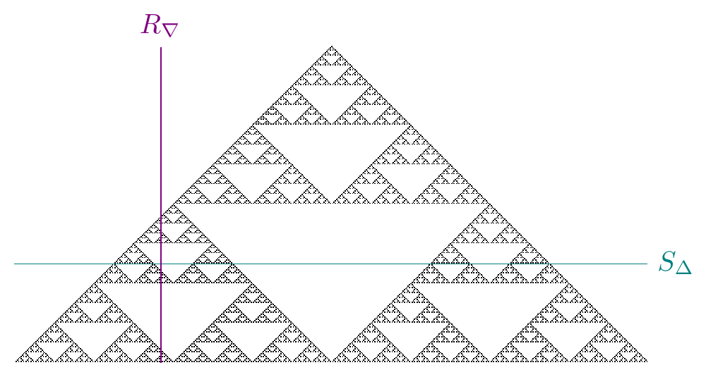

# Cryptanalysis of Chacha Using Modular Differences: Explaining the Neural Distinguisher in KIMSK

This repository contains an in-depth differential analysis of round-reduced [ChaCha](https://cr.yp.to/chacha/chacha-20080128.pdf), whose goal was to explain the origin of the surprisingly strong 3-round Neural Distinguisher found in the [KIMSK projects](https://www.bsi.bund.de/SharedDocs/Downloads/EN/BSI/Publications/Studies/Cryptography/KIMSK_Final-Report.pdf?__blob=publicationFile&v=4) by the BSI.

This project was done as a Bachelor thesis at the Chair for Symmetric Cryptography, Ruhr University Bochum, Germany.

## Motivation

Chacha is a widely used stream cipher of the ARX family, i. e., its round function consists only of modular addition, bit rotation and XOR. The vast majority of cryptanalytic attacks on Chacha in the literature are based on differential-linear distinguishers and several experimental observations.

In the KIMSK BSI projects, neural networks were trained to distinguish round-reduced Chacha from random, by only choosing the IV freely and observing the corresponding output. For three rounds, the network achieved an exceptionally high accuracy, which drops significantly as soon as the network is restricted to only observe XOR differences. This behaviour was then traced back to a simple trail, the so-called *Neural Distinguisher*, starting with an XOR difference $\Delta^{(0)}_{15} = \texttt{0x8000}$ on the IV and observing the *modular* difference $\nabla^{(2)}_9$ after two rounds, which can be computed deterministically from the output of three rounds. This points to the fact that the network was able to deduce more distinguishing information than only XOR differences, as typically done in differential cryptanalysis, and raises the question whether modular differences offer a generic advantage over XOR differences.

In order to describe the relationship between both difference types, we introduce compatibility sets $S_\Delta = \{ (b \oplus \Delta) \boxminus b \mid b \in \mathbb{Z}_{2^n} \}$, containing all modular differences compatible with a fixed XOR difference $\Delta$, and show that these sets are of recursive nature and form the Sierpinski triangle when arranged for all $\Delta$. This allows to efficiently switch between modular and XOR differences, as well as to show that $|S_\Delta| = 2^{\mathrm{hw}(\Delta)}$, where each element occurs with the same probability.

  

## Repository Contents

| File | Description |
| --- | --- |
| [`thesis.pdf`](thesis.pdf) | The full thesis, including all proofs and experimental results. |
| [`presentation.pdf`](presentation.pdf) | Slides of the thesis talk. |
